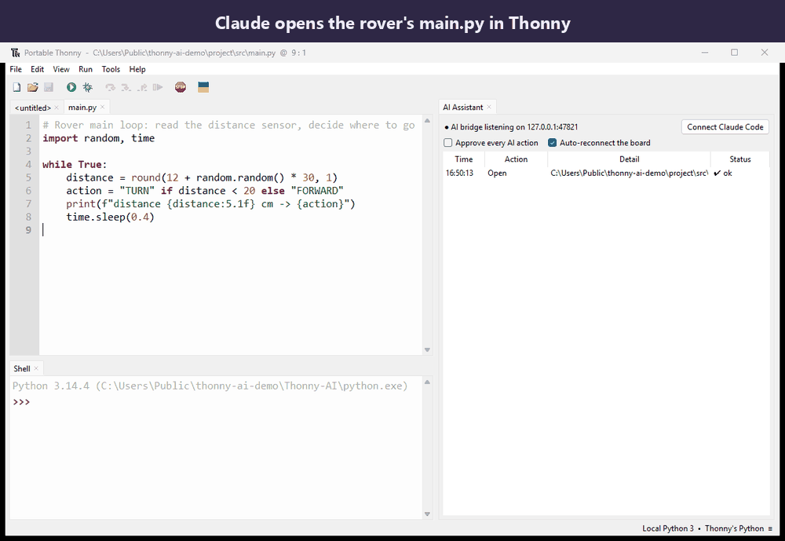
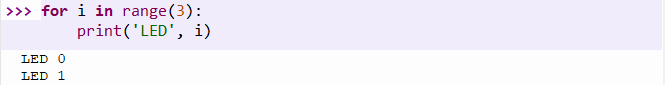
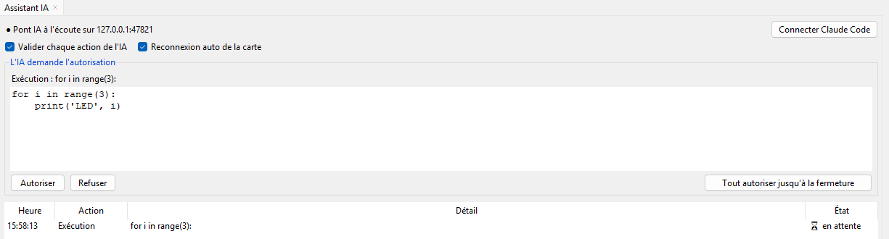
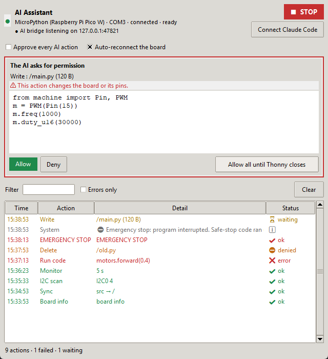
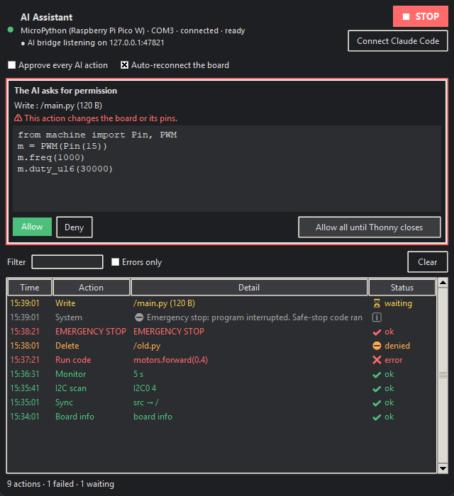
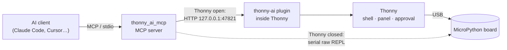

<div align="center">

# thonny-ai

**The MCP server and AI plugin for [Thonny](https://thonny.org).**
Let Claude Code, Claude Desktop, Cursor or any MCP client program your **Raspberry Pi Pico** and
**ESP32** in **MicroPython**, visibly, safely and hands-free.

[](https://github.com/AstroQuestStudio/thonny-ai/actions/workflows/tests.yml)
[](https://github.com/AstroQuestStudio/thonny-ai/releases)
[](LICENSE)




<sub>Recorded with Thonny's local Python interpreter; with a board connected, the same tools drive MicroPython on the board.</sub>

</div>

---

**thonny-ai** connects AI coding assistants to Thonny, the beginner-friendly Python IDE used in
many classrooms, and to the MicroPython board plugged into it. The AI can run code on the
board, read sensors, watch a robot's main loop, manage files and deploy a project. **Every command
appears in Thonny's shell, in front of you**, and you can require a click to approve each action.

- 🧑‍🏫 **For students and teachers**: the AI's work is visible and reviewable, not hidden in a chat.
- 🤖 **For makers**: “deploy, run, watch the sensor output, fix, repeat” without copy-paste.
- 🔌 **For MCP users**: a clean, dependency-free MCP server for real hardware.

## Contents

[Quick start](#quick-start) · [What you can ask](#what-you-can-ask) · [Features](#features) ·
[Tools](#mcp-tools) · [Compatibility](#compatibility) · [How it works](#how-it-works) ·
[Security](#security-model) · [FAQ](#faq) · [Contributing](#contributing)

## Quick start

**Option A: ready-made Thonny (Windows).** Download
[`Thonny-AI-portable.zip`](https://github.com/AstroQuestStudio/thonny-ai/releases/latest), unzip,
run `thonny.exe`. Nothing to install.

**Option B: your existing Thonny.** In Thonny, open *Tools → Open system shell…* and run:

```bash
pip install git+https://github.com/AstroQuestStudio/thonny-ai
```

Then restart Thonny, open **View → AI Assistant** and click **Connect Claude Code**. Done: start a
new Claude Code session (or type `/mcp`) and talk to your board.

<details>
<summary><b>Claude Desktop, Cursor, VS Code or another MCP client</b></summary>

The server is started with Thonny's own Python (`python -m thonny_ai_mcp`):

```json
{
  "mcpServers": {
    "thonny-ai": {
      "command": "C:/path/to/Thonny/python.exe",
      "args": ["-m", "thonny_ai_mcp"],
      "env": { "THONNY_AI_PROJECT": "C:/path/to/your/project" }
    }
  }
}
```

- **Claude Desktop**: `claude_desktop_config.json`
- **Cursor**: `.cursor/mcp.json`
- **Claude Code** (manual): `claude mcp add thonny-ai -s user -- "C:/path/to/Thonny/python.exe" -m thonny_ai_mcp`
- Any other client that speaks MCP over stdio works the same way.

On macOS / Linux use the `python3` Thonny runs with (*Tools → Open system shell…*, then `which python3`).
</details>

## What you can ask

> “Blink the Pico W's onboard LED 5 times.”
>
> “Read the internal temperature sensor every second for 10 seconds and tell me if it drifts.”
>
> “Start `src/main.py` and watch the ultrasonic distance readings. Are they noisy? Suggest a filter.”
>
> “Deploy `src/` to the board and check that `main.py` starts without errors.”
>
> “What files are on the board, and how much flash is left?”
>
> “My motor doesn't turn: check the PWM on GP15, then try duty 50%.”

## Features

| | |
|---|---|
| 👀 **Visible AI** | Code sent by the AI appears after `>>>` in Thonny's shell, syntax-highlighted and tinted, exactly as if it had been typed. |
| ✋ **Human in the loop** | *AI Assistant* panel: a log of every action (run, write, delete, sync…). Tick **Approve every AI action** and nothing touches the board until you click *Allow*. |
| 🔁 **Long-running programs** | `start` a robot loop or a sensor stream, `monitor` what it prints while it runs, `interrupt` it. The AI can debug code that never returns. |
| 🔌 **Auto-reconnect** | Replug the board, or survive a USB glitch: Thonny reconnects by itself. No more “Connection lost, use Stop/Restart”. A deliberate *Disconnect* is never undone. |
| ⚡ **Smart sync** | `sync` uploads a project folder and only sends files whose SHA-256 changed, then restarts `main.py`. |
| 🛑 **Robot safety** | `stop` interrupts the program **and** runs your `safe_stop` code (motors off): Ctrl-C alone leaves PWM outputs running. A timeout or `interrupt` does the same. Stop and interrupt are never blocked by the approval panel. |
| 🖥️ **Modern panel** | Live board status (port, connected, ready/running), a red **STOP** button (also in the Tools menu), colour-coded log that follows light and dark themes, filter and *errors only*, details window with Code / Result tabs and Copy, right-click copy, a warning on approval requests that change the board. |
| 🧾 **Per-project config** | `.thonny-ai.json` sets default folders, `ignore` patterns, the safe-stop code and an output cap, so one runaway `print` loop cannot flood the AI's context. |
| 🧰 **Works without Thonny** | Thonny closed? The MCP server talks to the board over the serial port (MicroPython raw REPL), and can even listen to `main.py` without stopping it. |
| 🪶 **Zero extra dependency** | Standard library + pyserial, which Thonny already bundles. |
| 🌍 **English / Français** | The UI follows Thonny's language. More languages welcome. |





The 0.2.0 panel, light and dark themes: live board status, red **STOP** button, approval card that
warns about actions changing the board, colour-coded log with filter, details window.

| Light | Dark |
|---|---|
|  |  |

## MCP tools

| Tool | What it does |
|---|---|
| `status` | How the board is reached right now: through Thonny (interpreter, port, state, approval mode) or direct serial |
| `info` | Board fact sheet: firmware, CPU MHz, free RAM and flash, unique id, Wi-Fi state, root files |
| `exec` | Run MicroPython code and return prints and tracebacks; a timeout interrupts runaway loops |
| `start` | Launch a program that runs forever (robot loop, data logger) without waiting |
| `monitor` | Read what the running program prints, without stopping it; `until` returns as soon as a regex shows up (e.g. `READY\|Traceback`) |
| `interrupt` | Stop the running program (Ctrl-C, escalating to Stop/Restart if needed), then run the safe-stop code if configured |
| `stop` | **Emergency stop** for robots: interrupt + `safe_stop` code so motors end up off (never waits for approval) |
| `run_file` | Run a local `.py` file on the board without saving it there |
| `ls` · `read` · `write` · `rm` | Manage the board's filesystem |
| `sync` | Upload a folder (default `src/`), only changed files, then soft-reset (`dry_run`, `force`, `ignore`, `delete`) |
| `pull` | Download board files into a local folder (backup / recover code), never overwrites without `overwrite` |
| `i2c_scan` | Scan an I2C bus and name the devices (IMU, OLED, distance sensor…) |
| `gpio` | Read or drive one pin (digital in/out, pull-ups, ADC) |
| `reset` | Soft reset: `boot.py` then `main.py` run again |
| `shell` | Read Thonny's shell, i.e. what the user sees |
| `open` | Open a local file in Thonny's editor |

## Compatibility

| | Status |
|---|---|
| **Thonny** 4.1+ (tested on 5.0) on Windows, macOS, Linux | ✅ unit tests on all three OS in CI |
| **Raspberry Pi Pico W**, MicroPython 1.29 | 🟢 early hardware tests passed (exec, files, deploy, through Thonny and serial); full [checklist](docs/hardware-testing.md) in progress |
| Raspberry Pi Pico / Pico 2 / Pico 2 W, ESP32, ESP32-S3, ESP8266 | 🟡 expected to work (same MicroPython raw REPL). [Send a hardware report](docs/hardware-testing.md) |
| CircuitPython boards | 🟡 untested. Reports welcome |
| **Claude Code**, Claude Desktop, Cursor, any MCP stdio client | ✅ standard MCP (protocol 2024-11-05 → 2025-06-18) |

## How it works



- A serial port can only be opened by one program. While Thonny is connected it owns the port, so
  the MCP server goes through Thonny. That is also why everything shows up in its shell.
- File transfers use Thonny's own backend commands, so they don't clutter the shell.
- Each MCP tool call is one **operation**: one approval and one row in the panel, even when it
  needs many round-trips (a `sync` of 20 files, for example).

## Security model

- The bridge listens on `127.0.0.1` only.
- Every request must carry the `X-Thonny-AI: 1` header, and requests with an `Origin` header are
  rejected, so web pages open in your browser cannot reach it.
- With *Approve every AI action* on, code execution and file changes wait for your click, and are
  denied after 2 minutes without an answer. Read-only actions (`status`, `info`, `ls`, `read`,
  `monitor`, `shell`) never wait.
- When you deny an action, the AI receives an explicit “denied by the user” error.

Found a problem? Please report it privately, see [SECURITY.md](SECURITY.md).

## FAQ

<details>
<summary><b>Is there an MCP server for Thonny?</b></summary>

Yes: thonny-ai. It ships a Thonny plugin and an MCP server (`python -m thonny_ai_mcp`) that lets any
MCP client drive Thonny and the MicroPython board connected to it.
</details>

<details>
<summary><b>Can Claude Code program a Raspberry Pi Pico or an ESP32?</b></summary>

Yes. With thonny-ai, Claude Code can run MicroPython on the board (`exec`), deploy a project
(`sync`), start a long-running program and read its output live (`start` + `monitor`), and manage
files, while you watch everything in Thonny.
</details>

<details>
<summary><b>Will the AI run code on my board without me knowing?</b></summary>

No. Its code is echoed in Thonny's shell and every action is logged in the *AI Assistant* panel. Turn
on *Approve every AI action* to allow or deny each action before it runs.
</details>

<details>
<summary><b>Do I need to keep Thonny open?</b></summary>

No. When Thonny is closed, the MCP server connects to the board over USB serial by itself. Keeping
Thonny open gives you the visual log, the approval gate and auto-reconnect.
</details>

<details>
<summary><b>How is this different from mpremote or rshell?</b></summary>

mpremote and rshell are command-line tools for humans and scripts. thonny-ai is built for AI agents
working next to a human: MCP tools with structured results, long-running program monitoring, and
visibility and approval inside the IDE students already use. They work well side by side.
</details>

<details>
<summary><b>Which AI models or clients are supported?</b></summary>

Any client that supports MCP over stdio: Claude Code, Claude Desktop, Cursor, VS Code with MCP, and
more. The model itself runs in your client. thonny-ai only runs locally.
</details>

<details>
<summary><b>Is it suitable for a classroom?</b></summary>

That is what it was designed for: everything the AI does is visible in the shell, logged in a panel,
and can require the student's (or teacher's) approval. It is MIT-licensed and free.
</details>

## Why not just copy-paste into a chatbot?

| | Copy-paste with a chatbot | CLI tools (mpremote…) | **thonny-ai** |
|---|---|---|---|
| AI runs code and reads the real output | ❌ you relay it | ⚠️ only through a shell tool | ✅ |
| Watch a running robot loop | ❌ | ⚠️ manual | ✅ `start` / `monitor` |
| Visible in the IDE, reviewable | ❌ | ❌ | ✅ |
| Approve each action | ❌ | ❌ | ✅ |
| Auto-reconnect after unplugging | ❌ | ❌ | ✅ |
| Beginner-friendly (Thonny) | ✅ | ❌ | ✅ |

## Configuration

| Setting | Where | Default |
|---|---|---|
| Approve every AI action | AI Assistant panel | off |
| Auto-reconnect the board | AI Assistant panel | on |
| Bridge port | `thonny_ai.port` in Thonny's configuration / `THONNY_AI_PORT` for the MCP server | 47821 |
| Folder for relative paths | `THONNY_AI_PROJECT` | MCP server working directory |
| Disable serial fallback | `THONNY_AI_SERIAL_FALLBACK=0` | enabled |
| Force a serial port | `THONNY_AI_SERIAL_PORT=COM3` | auto-detect |
| Safe-stop code (motors off) | `THONNY_AI_SAFE_CODE`, or `safe_stop` / `safe_stop_file` in `.thonny-ai.json` | none |
| Max characters returned per call | `THONNY_AI_MAX_OUTPUT`, or `max_output` in `.thonny-ai.json` | 20000 |

### `.thonny-ai.json` (optional, in the project folder)

```json
{
  "local_dir": "src",
  "remote_dir": "/",
  "ignore": ["*.md", "tests"],
  "safe_stop": "import motors; motors.stop()",
  "max_output": 20000
}
```

All keys are optional. `local_dir`, `remote_dir` and `ignore` are the defaults of `sync` and `pull`
(`ignore` also protects board files from `sync` with `delete`). `safe_stop` is MicroPython code run
after `stop`, `interrupt` or a timed-out `exec`: put the pins that drive motors, servos or relays
in their safe state there (a bare Ctrl-C does **not** stop PWM outputs on a Pico). `safe_stop_file`
points to a local `.py` file instead.

## Development

```bash
python -m pip install -e ".[test]"
PYTHONPATH=tests python -m unittest discover -s tests -v   # 116 tests, no board needed (panel tests need a display; skipped on headless CI)
python tests/e2e_thonny.py /path/to/thonny.exe             # 21 steps in a real Thonny window
python bundle/build_portable.py thonny-X.Y.Z-windows-portable.zip
```

The unit tests use a fake board (sandboxed filesystem) and a fake serial port speaking the
MicroPython raw REPL protocol. The end-to-end script drives a real Thonny through the MCP tools.
Real-board behaviour is checked with the [hardware checklist](docs/hardware-testing.md).

## Contributing

Contributions are very welcome, from a translation to a new tool: see
[CONTRIBUTING.md](CONTRIBUTING.md) and the
[good first issues](https://github.com/AstroQuestStudio/thonny-ai/labels/good%20first%20issue).
Hardware reports for boards other than the Pico W are especially useful.

## Roadmap

- [ ] PyPI release and listing in Thonny's plugin manager
- [ ] Wi-Fi (WebREPL): drive robots that can't stay on a USB cable
- [ ] Plotter and variable snapshots for the AI
- [ ] More UI languages

## Français

thonny-ai permet à un assistant IA (Claude Code ou tout client MCP) de piloter Thonny et ta carte
MicroPython (Raspberry Pi Pico, ESP32). Le code de l'IA s'affiche dans la console Thonny comme s'il
était tapé, chaque action peut être soumise à ta validation, l'IA peut lancer un programme qui tourne
en boucle (un robot) et lire ce qu'il affiche en direct, et Thonny se reconnecte tout seul quand on
rebranche la carte. L'interface est en français si Thonny est en français.

---

<div align="center">

If thonny-ai saves you time, a ⭐ helps other students and makers find it.

MIT © Mathis Cottereau · Not affiliated with the Thonny project: thonny-ai is a third-party plugin
built on Thonny's public plugin interface.

</div>
