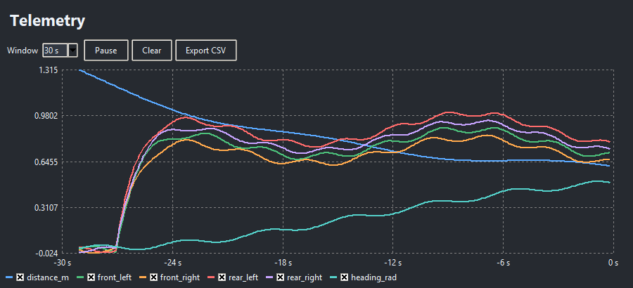

# Telemetry

Print numeric samples from a running MicroPython program to plot them in Thonny or collect
statistics with the `telemetry` MCP tool.

## Print samples

Emit one newline-terminated line per sample in your existing control loop.

```python
print("dist_cm=23.4 left_mps=0.52 right_mps=0.50 heading_deg=-1.2")
```

Both `=` and `:` work. Separate fields with spaces, commas or semicolons. Pair names can
start with an ASCII letter or underscore and can also contain digits, dots and hyphens.
The same format also accepts a JSON object.

```json
{"dist_cm": 23.4, "left_mps": 5.2e-1, "heading_deg": -1.2}
```

Telemetry reads finite numbers from standard output. Regular log messages can share the
stream. Series names are case-sensitive and can be up to 64 characters long. Keep sample
lines within 4,096 characters.

## Plot in Thonny

Open **View → Telemetry** or **Tools → Telemetry**. The view starts collecting when you open
it. Choose a **10**, **30** or **60 s** window. Toggle series using the checkboxes in the
legend. The shared vertical axis scales to the visible series, so hiding a series can help
inspect signals with different units.

**Pause** freezes the displayed window and skips incoming samples until **Resume**.
**Clear** empties the history. **Export CSV** saves the selected time window, including
hidden series, with columns `elapsed_seconds`, `series` and `value`. CSV timestamps are
seconds since the view opened. The chart redraws at up to 10 Hz and retains up to 16 series
and the latest 2,048 samples per series within 60 seconds.



## Read statistics via MCP

Call the read-only `telemetry` tool while the program is running. This call collects three
series over five seconds.

```json
{"seconds": 5, "series": ["dist_cm", "left_mps", "right_mps"], "points": 5}
```

- `seconds` defaults to 5. Pass a positive value up to 300. With Thonny, capture can end
  early when the program exits. With Thonny closed, the server can listen to the USB serial
  console while a program such as `main.py` is running.
- `series` is an optional list of exact names. Omit it to collect all detected series, up
  to 16 per call. `series_limited` is true if matching series were skipped due to this limit.
- `points` defaults to 0. Pass up to 50 to include the latest points per series as
  `[seconds_since_capture_started, value]`.

The tool returns a JSON object with `backend`, `elapsed_seconds`, `running` and a
`series` object keyed by name. Each series reports `last`, `min`, `max`, `mean`,
`stddev` (population standard deviation), `count`, and `rate_hz`. These statistics cover
all samples received for the series during the call. On a passive serial connection,
`running` is `null`.

Both the plot and the MCP tool use host arrival time. MCP reads output in roughly 200 ms
batches and assigns the same timestamp to the complete lines delivered in a batch.
`rate_hz` estimates the sample rate from `(count - 1) / (last_time - first_time)`.
It is `null` when all points have the same timestamp. For control-loop timing measurements,
emit a device timestamp as a separate numeric field.
